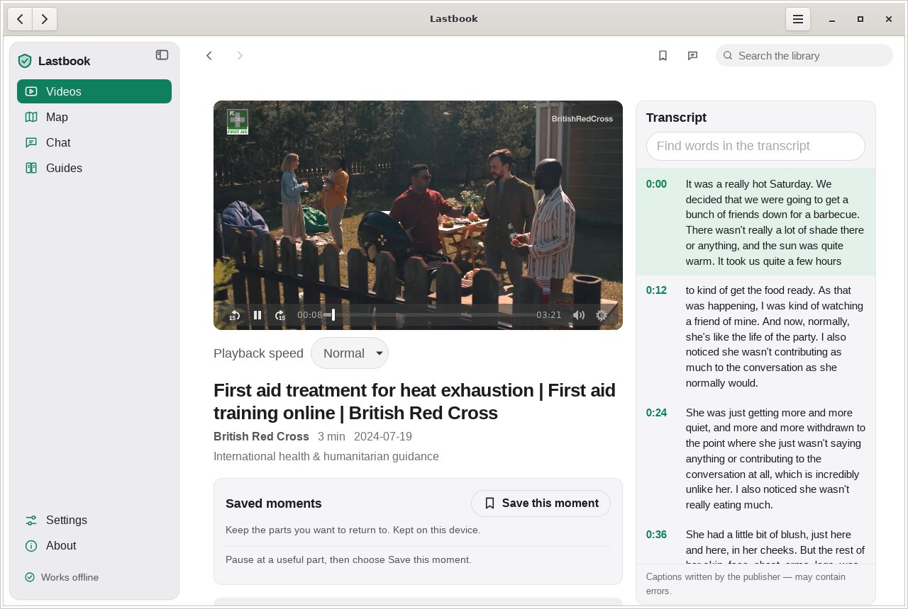
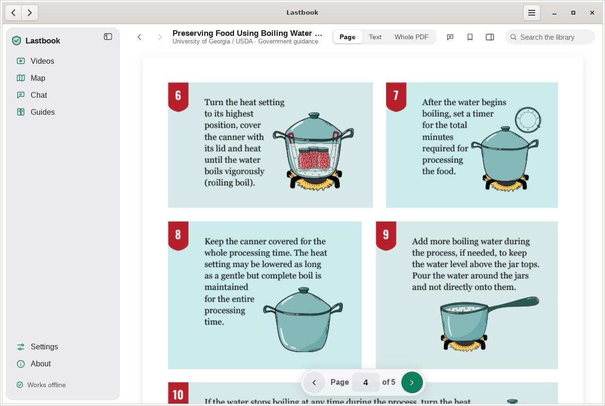
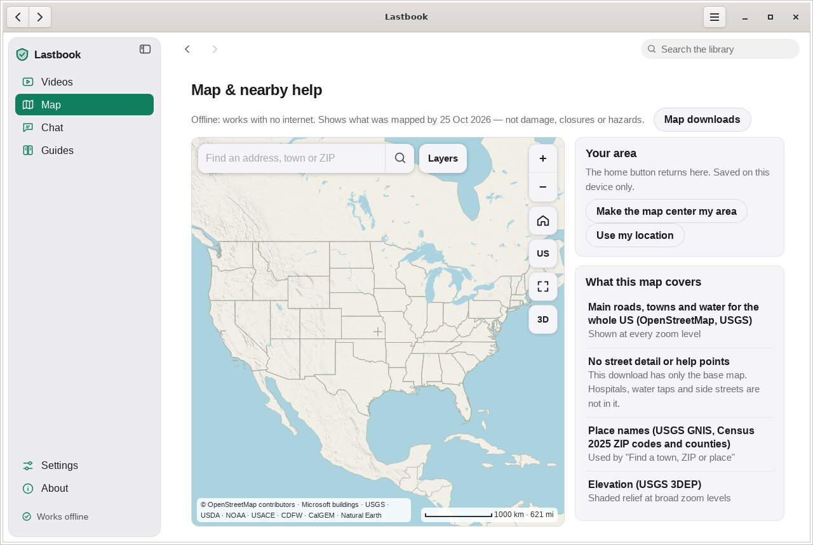

# Flatpak (proof of concept)

A Flatpak of Lastbook 1.1.15 on the GNOME 51 runtime, built from the `v1.1.15` tag with no changes to Lastbook's code. It packs the same tree as the `.deb` (`packaging/linux/build_app_linux.sh`), rooted at `/app/lastbook` instead of `/opt/lastbook`. The proposal and the questions it raises are in the linked issue.

This is a proof of concept, not a finished build: no local AI runner yet, no package scan, and no Flatpak-only changes to the update check or Apple silicon detection. `poc-screenshots/` is here for the proposal only.

## Files

- `org.lastbook.Lastbook.yml`: the manifest. The repo is pinned by tag and commit, and the six wheels by SHA-256 for x86_64 and aarch64, so the build needs no network. The copy steps follow `build_app_linux.sh`'s list. 1.1.15 added `app/ui_language.py` to that list, and the manifest had to add it too, so a real build should share one list.
- `org.lastbook.Lastbook.metainfo.xml`: AppStream data. The store screenshots are the project's own, from `website-next/` at `v1.1.15`.
- `org.lastbook.Lastbook.png`: `packaging/icon/tile-1024.png` at 512 px, the largest icon Flatpak exports. It is resized outside the build, because GNOME 51's image loaders run in a sandbox of their own that can't start inside `flatpak-builder`.
- `manifest-v1.json`: the setup manifest, as published at downloads.lastbook.org. Release builds would make it with `packaging/release_manifest.py`.
- `smoke_flatpak.sh`: the smoke test, following `smoke_deb.sh`.

## Build and run

```sh
flatpak install --user flathub org.gnome.Platform//51 org.gnome.Sdk//51
cd packaging/linux/flatpak
flatpak-builder --user --install --force-clean --repo=repo build org.lastbook.Lastbook.yml
flatpak run org.lastbook.Lastbook

# a single file for a release page
flatpak build-bundle --runtime-repo=https://dl.flathub.org/repo/flathub.flatpakrepo repo Lastbook.flatpak org.lastbook.Lastbook
```

## Smoke test

`smoke_flatpak.sh` expects a library in the app's own data folder. For example, unpack the Small pack there:

```sh
mkdir -p ~/.var/app/org.lastbook.Lastbook/data/Lastbook
cd ~/.var/app/org.lastbook.Lastbook/data/Lastbook && unzip /path/to/Lastbook-Small-20261113.zip
bash packaging/linux/flatpak/smoke_flatpak.sh /tmp/flatpak-shots    # needs Xvfb, openbox, xdotool, ImageMagick, iproute2
```

On x86_64 with AMD graphics, all 11 checks pass, both from a `flatpak-builder` install and from the bundle:

- AV1 (dav1d) and H.264 (codecs-extra) videos from the library decode to the end inside the sandbox.
- The window opens on the library, and a video plays through `lastbooksrc`.
- A second copy exits at once.
- No listening sockets.
- Ctrl+Q ends the app and its WebKit processes.
- Setup opens with no library, and reads the disk, memory and GPU from inside the sandbox.
- The library is left in place.

Checked by hand:

- library search
- the PDF reader
- the offline map
- Check for updates, which reached downloads.lastbook.org through `engine/setup/roots.pem`

**Flathub's linter.** `flatpak-builder-lint manifest` passes. `flatpak-builder-lint repo` reports only `appstream-external-screenshot-url` and `appstream-remote-icon-not-mirrored`. Both are about Flathub's media server, and the linter skips them inside Flathub's build pipeline.

| | | |
|---|---|---|
|  |  |  |
